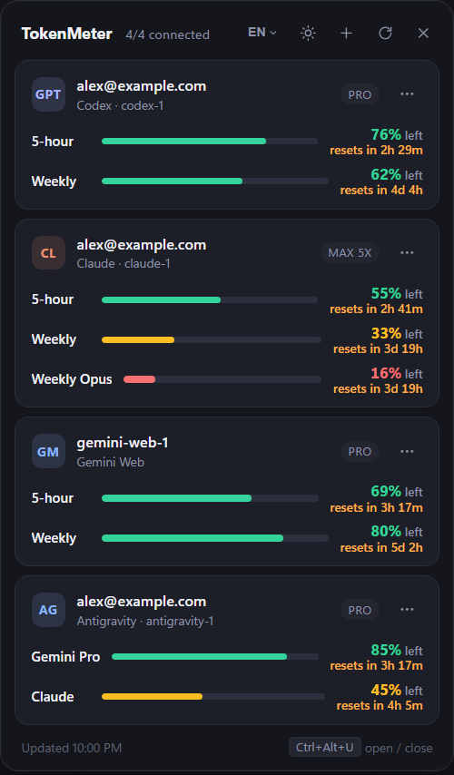

# TokenMeter

[English](README.md) · [中文](README.zh.md) · **한국어**

Codex, Claude, Gemini 웹과 Antigravity의 남은 사용량을 보여주는 Windows 트레이 앱.



- 트레이 아이콘 클릭 또는 `Ctrl+Alt+U`로 창 열기/닫기 (`Esc`로 닫기)
- 트레이 아이콘은 가장 많이 쓴 윈도우 기준 링 게이지. 초록 < 50%, 주황 < 80%, 그 이상 빨강
- 60초마다 자동 갱신, Windows 시작 시 자동 실행 (둘 다 설정 가능)
- 다크/라이트 테마, English / 中文 / 한국어. 헤더에서 전환
- 같은 서비스의 여러 계정을 한 화면에 나란히 표시. 카드를 끌어 순서 변경
- 새 버전 알림과 트레이 메뉴에서 한 번 눌러 업데이트

## 설치

[Releases](https://github.com/HSoo-Kim/TokenMeter/releases)에서 `TokenMeter-Setup-<버전>.exe`를 받아 실행한다.
사용자 단위 설치라 관리자 권한을 묻지 않고 설치 폴더도 고를 수 있다. 제거는 Windows 설정 → 앱에서 하며,
`%APPDATA%\TokenMeter`의 설정은 남는다.

코드 서명을 하지 않아 처음 실행할 때 SmartScreen이 "Windows의 PC 보호" 창을 띄운다.
**추가 정보 → 실행**을 누르면 된다.

### 업데이트

1.3.0부터 시작 시와 6시간마다 GitHub Releases에서 새 안정 버전을 확인한다.
새 버전이 있으면 Windows 알림과 트레이 우클릭 메뉴의 **v...로 업데이트** 항목이 나타난다.
누르면 설치 파일을 받고 GitHub 릴리즈 메타데이터의 SHA-256과 크기를 검증한 뒤,
같은 폴더에 설치하고 다시 시작한다. 계정 설정과 로그인은 유지한다.
자동 확인은 알림만 표시하며, 설치는 업데이트 항목을 눌러야 시작된다.
트레이에서 **업데이트 확인**을 직접 실행하거나 **새 버전 자동 확인**을 끌 수도 있다.
소스 실행 중이거나 검증 가능한 설치 파일이 없는 릴리즈는 릴리즈 페이지를 연다.

1.2.1 이하는 업데이트 기능이 없으므로 1.3.0을 한 번 직접 설치해야 이후 알림을 받을 수 있다.

보려는 서비스의 CLI는 따로 설치돼 있어야 한다. TokenMeter가 그 CLI가 저장해 둔 자격증명을 읽기 때문이다.
[`codex`](https://developers.openai.com/codex/cli),
[`claude`](https://docs.claude.com/en/docs/claude-code/overview). Windows 10 또는 11이 필요하다.

### 소스에서 실행

```
git clone https://github.com/HSoo-Kim/TokenMeter.git
cd TokenMeter
npm install
npm start        # 실행
npm run dist     # dist/TokenMeter-Setup-<버전>.exe 생성
```

이 방식은 [Node.js](https://nodejs.org) 20 이상이 필요하다. `TokenMeter.cmd`는 `npm start`와 같다.

## 사용량을 읽는 방식

Codex와 Claude는 CLI가 PC에 저장한 OAuth 자격증명을 읽고, 만료된 토큰은 같은 파일에 갱신한다.
Gemini 웹은 TokenMeter 전용 브라우저 세션에서 Google에 로그인한다.
Antigravity는 실행 중인 로컬 언어 서버에서 한도를 읽으며 로그인 자격증명을 복사하지 않는다.

| 서비스 | 자격증명 파일 | usage 엔드포인트 |
|---|---|---|
| Codex | `<home>/auth.json` | `chatgpt.com/backend-api/wham/usage` |
| Claude | `<home>/.credentials.json` | `api.anthropic.com/api/oauth/usage` |
| Gemini 웹 | `<home>`의 전용 브라우저 세션 | Gemini 웹 사용량 GraphQL |
| Antigravity | 실행 중이고 로그인된 로컬 앱 | 인증된 루프백 한도 RPC |
| Gemini CLI (기존 Code Assist 라이선스) | `<home>/oauth_creds.json` | `cloudcode-pa.googleapis.com/v1internal:retrieveUserQuota` |

Claude는 모델별 주간 한도도 내려주므로, API가 값을 주는 동안 `주간 Opus` 같은 행이 함께 표시된다.

### Google 계정

`+`에서 **Gemini 웹**을 추가하거나 **Antigravity**를 연결한다. 서로 다른 한도이므로 합치지 않는다.
Gemini 웹은 서버가 반환한 5시간·주간 한도를 표시한다. 열린 창에서 Google 로그인 후 창을 닫으면
카드가 갱신된다. 계정마다 전용 세션을 사용하며 로그아웃해도 Chrome 로그인은 유지된다.
Antigravity는 앱을 실행하고 로그인해 두어야 한다. 공유된 앱 계정은 TokenMeter에서 로그아웃할 수 없다.
응답에 없는 잔여율이나 초기화 시각은 임의로 표시하지 않는다.

개인 계정의 Gemini CLI Google 로그인은 2026년 6월 18일 종료됐다. CLI 항목은 기존 Code Assist
라이선스 계정용이며 Google AI Pro/Ultra 웹 구독 한도가 아니다. 공식 `gemini` CLI를 설치하고
대화형 Google 로그인과 프로젝트 설정을 완료해야 한다. 새 계정은 별도 `GEMINI_CLI_HOME` 아래의
`.gemini/oauth_creds.json`을 사용한다. 해당 폴더의 `settings.json`에
`{"tokenmeter":{"project":"project-id"}}`로 프로젝트를 지정할 수도 있다.
토큰 갱신에 필요한 OAuth 클라이언트는 설치된 공식 CLI 번들에서 읽는다. 별도 클라이언트 값을 배포하지 않는다.
표준 설치 경로가 아니라면 `tokenmeter.cliPath`에 공식 Gemini CLI 패키지 폴더를 지정한다.
[Google 개인 계정 지원 종료 안내](https://developers.google.com/gemini-code-assist/docs/deprecations/code-assist-individuals) 참고.

## 계정

설정은 `%APPDATA%\TokenMeter\config.json`에 저장된다. 항목 하나가 계정 하나이고, `home`은 그 계정의
CLI 자격증명 폴더다.

```json
{
  "hotkey": "Ctrl+Alt+U",
  "theme": "dark",
  "lang": "en",
  "pollSeconds": 60,
  "accounts": [
    { "id": "codex-1", "type": "codex", "home": "~/.codex" },
    { "id": "codex-2", "type": "codex", "home": "~/.codex-2" },
    { "id": "claude-1", "type": "claude", "home": "~/.claude" }
  ]
}
```

- 카드를 위아래로 끌면 순서가 바뀌고 그대로 저장된다. `⋯` 메뉴에도 위로 이동 / 아래로 이동이 있다
- 카드의 `⋯`: 로그인(공식 웹 OAuth 창), 로그아웃, 자격증명 폴더 열기, 목록에서 제거
- 헤더의 `+`: 계정 추가. `~/.codex-2` 같은 새 폴더를 만들고 거기서 로그인
- 로그인은 `CODEX_HOME` / `CLAUDE_CONFIG_DIR`를 그 폴더로 지정해 `codex login` / `claude auth login`을 실행한다.
  계정끼리 격리되고 기존 CLI 세션은 건드리지 않는다
- 로그아웃은 해당 자격증명 파일을 삭제하므로 같은 폴더를 쓰는 CLI도 함께 로그아웃된다

## 설정

테마, 언어, 단축키는 앱에서 바꾸면 `config.json`에 저장된다. 하단 단축키 칩을 클릭하면 새 조합을 녹화한다.
Ctrl / Alt / Shift 중 하나는 반드시 포함해야 하고 `Esc`로 취소한다. 다른 앱이 이미 쓰는 조합이면 기존 값을 유지한다.

트레이 메뉴의 "설정 파일 열기"로 해당 파일을 바로 열 수 있다. 직접 고칠 때는 앱을 먼저 종료(트레이 메뉴 → 종료)한 뒤 수정하고 다시 실행한다.

## 개발

```
set TOKENMETER_DEMO=1 && set TOKENMETER_SHOT=%CD%\docs\screenshot.png && npm start
```

예시 계정으로 한 프레임을 렌더해 PNG로 저장하고 종료한다. `TOKENMETER_DEMO`를 빼면 실제 데이터로 찍는다.

`npm run test:providers`는 Google 제공자 테스트, `npm run test:ui`는 작은·큰 창의 라이트·다크 화면과
실제 preload IPC를 검증한다.

## 라이선스

MIT
