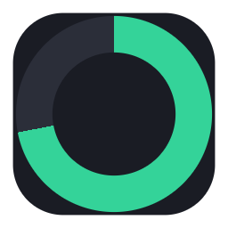
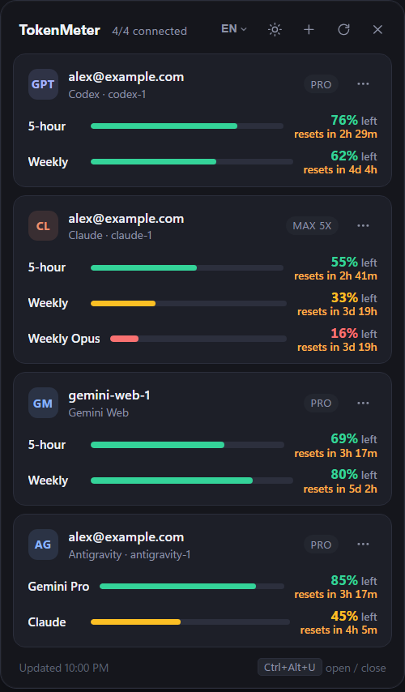

<div align="center">



# TokenMeter

**Your AI subscription limits, together in the Windows tray or the macOS menu bar.**

<p>
  <a href="https://github.com/HSoo-Kim/TokenMeter/releases/latest/download/TokenMeter-Setup.exe"></a>
  <a href="https://github.com/HSoo-Kim/TokenMeter/releases/latest/download/TokenMeter-mac-arm64.dmg"></a>
  <a href="https://github.com/HSoo-Kim/TokenMeter/releases/latest/download/TokenMeter-mac-x64.dmg"></a>
  <a href="https://github.com/HSoo-Kim/TokenMeter/releases/latest"></a>
  <a href="https://github.com/HSoo-Kim/TokenMeter/releases"></a>
  <a href="https://github.com/HSoo-Kim/TokenMeter/stargazers"></a>
  <a href="LICENSE"></a>
</p>

<p><b>English</b> · <a href="README.ko.md">한국어</a> · <a href="README.zh.md">中文</a></p>



<p><sub>Example accounts and quota values. The Downloads badge counts GitHub Release asset downloads.</sub></p>

</div>

TokenMeter is a Windows tray and macOS menu bar app for checking remaining Codex, Claude, Gemini web and Antigravity
quota without opening each service. Limits and reset times depend on what each provider returns.

## At a glance

| Feature | What it does |
|---|---|
| **One panel, separate quotas** | Shows Codex, Claude, Gemini web and Antigravity accounts together without combining their usage pools. A legacy Gemini CLI option is available for licensed Code Assist accounts. |
| **Limits and resets** | Displays available 5-hour, weekly and model-specific limits with remaining percentages and reset times when reported. |
| **Multiple accounts** | Add several accounts for the same service and drag their cards into order. |
| **Always at hand** | Open from the tray or menu bar icon, or with `Ctrl+Alt+U` (`⌃⌥U` on macOS). The ring gauge reflects the most-used limit; quota refreshes every 60 seconds by default. |
| **Make it yours** | Switch between dark and light themes, choose English, Korean or Chinese, change the shortcut and start with Windows or at macOS login. |
| **Updates on your terms** | Get a new-version notification and start a verified installer from the tray or menu bar icon. |

## Download

| Platform | File |
|---|---|
| Windows 10 / 11 (x64) | [TokenMeter-Setup.exe](https://github.com/HSoo-Kim/TokenMeter/releases/latest/download/TokenMeter-Setup.exe) |
| macOS 13+ · Apple silicon | [TokenMeter-mac-arm64.dmg](https://github.com/HSoo-Kim/TokenMeter/releases/latest/download/TokenMeter-mac-arm64.dmg) |
| macOS 13+ · Intel | [TokenMeter-mac-x64.dmg](https://github.com/HSoo-Kim/TokenMeter/releases/latest/download/TokenMeter-mac-x64.dmg) |

Not sure which Mac you have? Apple menu → **About This Mac** lists an Apple chip (Apple silicon) or an Intel processor.
These links always fetch the latest release. Every version and file is on the [Releases](https://github.com/HSoo-Kim/TokenMeter/releases) page; once installed,
TokenMeter tells you when a newer version is out.

## Quick Start

### Windows

1. Download `TokenMeter-Setup.exe` from [Download](#download) on Windows 10 or 11 (x64).
2. Run the installer. It installs per user without administrator rights and lets you choose the install folder.
3. Click the tray icon or press `Ctrl+Alt+U`; use `+` to add an account. For Codex or Claude login, install the corresponding [`codex`](https://developers.openai.com/codex/cli) or [`claude`](https://docs.claude.com/en/docs/claude-code/overview) CLI.

The installer is unsigned, so Windows SmartScreen may show “Windows protected your PC”: choose
**More info → Run anyway**. Uninstall from Windows Settings → Apps; settings in `%APPDATA%\TokenMeter` are kept.

### macOS

1. Download the disk image for your Mac from [Download](#download); macOS 13 or later is required.
2. Open the disk image and drag TokenMeter into Applications.
3. Click the ring in the menu bar or press `⌃⌥U` (Control+Option+U); right-click the ring for the menu. TokenMeter has no Dock icon.
4. Use `+` to add an account. Codex and Claude login need the same `codex` or `claude` CLI as on Windows; it runs in Terminal.

The app is ad-hoc signed but not notarized, so the first launch is blocked: open System Settings → Privacy & Security
and choose **Open Anyway**. On a notched display a crowded menu bar can hide the ring; the shortcut still opens the panel.
Uninstall by moving the app to the Trash; settings in `~/Library/Application Support/TokenMeter` are kept.

### Updates

Starting with 1.3.0, TokenMeter checks GitHub Releases at startup and every 6 hours. A new stable
version shows a Windows notification and an **Update to v...** item in the tray's right-click menu.
Click it to download the installer, verify its SHA-256 and size against GitHub's release metadata,
then install and restart in the same folder. Account settings and sign-ins are kept.
Only the update action installs anything; automatic checks do not install updates.
The tray menu also offers **Check for updates** and an automatic-check toggle.
Source runs or releases without a verifiable installer open the release page instead.

Versions 1.2.1 and older have no updater. Install 1.3.0 manually once to receive future notifications.

On macOS (1.4.0 and later) the notification comes from Notification Center and the update items are in the menu bar
icon's right-click menu. The update downloads `TokenMeter-<version>-mac-<arch>.zip` for the Mac's CPU, verifies it
the same way, replaces the app where it is installed and reopens it. The folder holding the app must be writable
for your user; otherwise the update fails and the running version stays.

### From source

```
git clone https://github.com/HSoo-Kim/TokenMeter.git
cd TokenMeter
npm install
npm start        # run it
npm run dist     # build dist/TokenMeter-Setup-<version>.exe
npm run dist:mac # on macOS: build dist/TokenMeter-<version>-mac-<arch>.dmg and .zip
```

[Node.js](https://nodejs.org) 20+ is required for this path. `TokenMeter.cmd` starts the app the same way
`npm start` does on Windows.

## How it reads your quota

Codex and Claude use the OAuth credentials their CLIs already store on your machine. Expired tokens
are refreshed in the same file. Gemini web uses Google sign-in in an isolated TokenMeter browser session.
Antigravity is read through its running local language server; its login credentials are not copied.

| Provider | Credential file | Usage endpoint |
|---|---|---|
| Codex | `<home>/auth.json` | `chatgpt.com/backend-api/wham/usage` |
| Claude | `<home>/.credentials.json` (macOS: login keychain) | `api.anthropic.com/api/oauth/usage` |
| Gemini web | Isolated browser session in `<home>` | Gemini web usage GraphQL |
| Antigravity | Running, signed-in local app | Authenticated loopback quota RPC |
| Gemini CLI (legacy licensed Code Assist) | `<home>/oauth_creds.json` | `cloudcode-pa.googleapis.com/v1internal:retrieveUserQuota` |

Claude reports per-model weekly limits too, so a `Weekly Opus` row appears whenever the API returns one.

On macOS, Claude Code keeps its login in the login keychain instead of `.credentials.json`: the item is
`Claude Code-credentials` for `~/.claude` and `Claude Code-credentials-<8 hex>` for any other folder, the same name
the CLI derives from `CLAUDE_CONFIG_DIR`. TokenMeter reads and refreshes that item through `/usr/bin/security`
and falls back to the file when there is no item.

### Google accounts

Use `+` to add **Gemini web** or connect **Antigravity**. These are separate quota pools, not one shared
subscription balance. Gemini web shows the reported 5-hour and weekly limits; sign in with Google in
the window that opens, then close it to refresh the card. Each account has its own session. Logging out
clears only that TokenMeter session, not Chrome. Antigravity must stay running and signed in. Its shared
local account cannot be logged out from TokenMeter. Unknown percentages or reset times are not invented.
On macOS TokenMeter looks for `Antigravity.app` or `Antigravity IDE.app` in `/Applications` or `~/Applications`.

Consumer Google login for Gemini CLI ended June 18, 2026. The CLI option is for existing licensed Code
Assist accounts, not Google AI Pro/Ultra web subscription quota. It requires the official `gemini` CLI;
run interactive Google sign-in and complete project setup there. For each new CLI account, TokenMeter
sets `GEMINI_CLI_HOME` to a separate base directory and reads its `.gemini/oauth_creds.json`.
An explicit project can be set in that folder's `settings.json` as `{"tokenmeter":{"project":"project-id"}}`.
Token refresh reads the OAuth client from the installed official CLI bundle, not from bundled credentials.
For a nonstandard installation, set `tokenmeter.cliPath` to the official Gemini CLI package directory.
See Google's [individual-account deprecation notice](https://developers.google.com/gemini-code-assist/docs/deprecations/code-assist-individuals).

## Accounts

Settings live in `%APPDATA%\TokenMeter\config.json` (macOS: `~/Library/Application Support/TokenMeter/config.json`).
One entry there is one account, and `home` is that account's CLI credential folder:

```json
{
  "hotkey": "Ctrl+Alt+U",
  "theme": "dark",
  "lang": "en",
  "pollSeconds": 60,
  "accounts": [
    { "id": "codex-1", "type": "codex", "home": "~/.codex" },
    { "id": "codex-2", "type": "codex", "home": "~/.codex-2" },
    { "id": "claude-1", "type": "claude", "home": "~/.claude" }
  ]
}
```

- Drag a card up or down to reorder the list; the order is saved. The `⋯` menu also has Move up / Move down
- `⋯` on a card: log in (opens the provider's web OAuth flow), log out, open the credential folder, remove
- `+` in the header: add an account, which creates a new folder such as `~/.codex-2` and logs in there
- Logging in runs `codex login` / `claude auth login` in a console window (Terminal on macOS) with `CODEX_HOME` /
  `CLAUDE_CONFIG_DIR` pointed at that folder, so each account stays isolated and your existing CLI sessions are untouched.
  On macOS the `~/.claude` account runs without `CLAUDE_CONFIG_DIR`, so it shares the keychain item of a plain `claude`
- Logging out deletes that credential file (on macOS, also Claude's keychain item), which also signs out any CLI using the same folder

## Settings

Theme, language and hotkey are changed in the app and saved to `config.json`. The hotkey chip in the footer
records a new combination: click it, press the keys (one of Ctrl / Alt / Shift is required; on macOS ⌃ / ⌥ / ⇧ / ⌘),
`Esc` cancels. If another app already owns the combination, the old one is kept.

The tray menu (on macOS, the menu bar icon's right-click menu) has **Open config.json** if you want to edit it by hand;
do that with the app closed (same menu → Quit), then start it again.

## Development

```
set TOKENMETER_DEMO=1 && set TOKENMETER_SHOT=%CD%\docs\screenshot.png && npm start
```

On macOS:

```
TOKENMETER_DEMO=1 TOKENMETER_SHOT="$PWD/docs/screenshot.png" npm start
```

Renders one frame with fake accounts, writes the PNG and exits. Drop `TOKENMETER_DEMO` to capture real data.

`npm run test:providers` runs the Google provider tests. `npm run test:ui` checks real renderer/preload
integration at short and tall desktop heights in both themes.

### Releasing

Set `version` in `package.json`, commit, and push a matching `vX.Y.Z` tag. GitHub Actions
([release.yml](.github/workflows/release.yml)) builds and tests on Windows and macOS, installs and launches the Windows
installer, and attaches every file to that tag's release, creating a draft if needed. It also adds version-free
copies (`TokenMeter-Setup.exe`, `TokenMeter-mac-arm64.dmg`, `TokenMeter-mac-x64.dmg`) for the download links above.
Write the notes and publish the draft; the in-app updaters only see published releases.

## License

MIT
