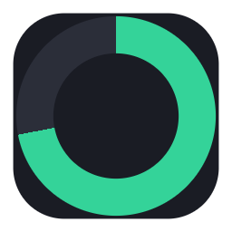

<div align="center">



# TokenMeter

**在 Windows 托盘中，一览你的 AI 订阅额度。**

<p>
  <a href="https://github.com/HSoo-Kim/TokenMeter/releases/latest"></a>
  <a href="https://github.com/HSoo-Kim/TokenMeter/releases/latest"></a>
  <a href="https://github.com/HSoo-Kim/TokenMeter/releases"></a>
  <a href="https://github.com/HSoo-Kim/TokenMeter/stargazers"></a>
  <a href="LICENSE"></a>
</p>

<p><a href="README.md">English</a> · <a href="README.ko.md">한국어</a> · <b>中文</b></p>


<p><sub>画面中的账号和额度为示例。Downloads 徽章统计 GitHub Release 文件的累计下载量。</sub></p>

</div>

TokenMeter 是 Windows 托盘应用，可在一处查看 Codex、Claude、Gemini 网页和 Antigravity
的剩余额度。显示哪些额度和重置时间取决于各服务返回的数据。

## 主要功能

| 功能 | 说明 |
|---|---|
| **一个面板，独立额度** | 同时显示 Codex、Claude、Gemini 网页和 Antigravity 账号，不合并各自的额度池；也支持已有 Code Assist 许可的 Gemini CLI。 |
| **剩余额度与重置** | 显示服务返回的 5 小时、每周及模型专属额度，以及剩余百分比和重置时间。 |
| **多个账号** | 可添加同一服务的多个账号，拖动卡片调整顺序。 |
| **随时查看** | 点击托盘图标或按 `Ctrl+Alt+U` 打开面板。环形图标反映使用最多的额度；默认每 60 秒刷新。 |
| **按需设置** | 切换深色与浅色主题、中文／English／한국어，设置快捷键及开机自启动。 |
| **自行选择更新** | 收到新版本通知后，可从托盘菜单启动已验证安装包的更新。 |

## 快速开始

1. 在 Windows 10 或 11（x64）上，从[最新版本](https://github.com/HSoo-Kim/TokenMeter/releases/latest)下载 `TokenMeter-Setup-<版本>.exe`。
2. 运行安装包。应用安装在当前用户下，无需管理员权限，并可选择安装目录。
3. 点击托盘图标或按 `Ctrl+Alt+U` 打开面板，通过 `+` 添加账号。登录 Codex 或 Claude 需安装对应的 [`codex`](https://developers.openai.com/codex/cli) 或 [`claude`](https://docs.claude.com/en/docs/claude-code/overview) CLI。

安装包未做代码签名，SmartScreen 可能提示“Windows 已保护你的电脑”；选择
**更多信息 → 仍要运行**即可。卸载可在 Windows 设置 → 应用中进行，`%APPDATA%\TokenMeter` 里的配置会保留。

### 更新

从 1.3.0 起，TokenMeter 在启动时及每 6 小时检查 GitHub Releases 的稳定版本。
发现新版本时显示 Windows 通知，并在托盘右键菜单中显示 **更新到 v...**。
点击后下载安装包，根据 GitHub 发布元数据验证 SHA-256 和大小，然后在原目录安装并重新启动。
账号设置和登录状态会保留。自动检查仅显示通知，安装须由用户点击更新。
托盘菜单也提供 **检查更新** 和 **自动检查更新** 开关。
源码运行或没有可验证安装包时，将打开发布页面。

1.2.1 及更早版本没有更新功能，需先手动安装一次 1.3.0，之后才能收到通知。

### 从源码运行

```
git clone https://github.com/HSoo-Kim/TokenMeter.git
cd TokenMeter
npm install
npm start        # 运行
npm run dist     # 生成 dist/TokenMeter-Setup-<版本>.exe
```

这种方式需要 [Node.js](https://nodejs.org) 20+。`TokenMeter.cmd` 与 `npm start` 效果相同。

## 额度是怎么读到的

Codex 和 Claude 使用其 CLI 已保存在本机的 OAuth 凭据，并在原文件中刷新过期令牌。
Gemini 网页使用 TokenMeter 独立浏览器会话登录 Google。Antigravity 通过正在运行的本地语言服务器
读取额度，不复制其登录凭据。

| 服务 | 凭据文件 | 用量接口 |
|---|---|---|
| Codex | `<home>/auth.json` | `chatgpt.com/backend-api/wham/usage` |
| Claude | `<home>/.credentials.json` | `api.anthropic.com/api/oauth/usage` |
| Gemini 网页 | `<home>` 中的独立浏览器会话 | Gemini 网页用量 GraphQL |
| Antigravity | 正在运行且已登录的本地应用 | 经认证的本地额度 RPC |
| Gemini CLI（已有 Code Assist 许可） | `<home>/oauth_creds.json` | `cloudcode-pa.googleapis.com/v1internal:retrieveUserQuota` |

Claude 还会返回按模型区分的每周额度，接口返回时就会多出一行 `每周 Opus`。

### Google 账号

点击 `+` 添加 **Gemini 网页**或连接 **Antigravity**。两者额度互相独立，不合并显示。
在打开的 Google 窗口登录后关闭窗口，即可刷新网页账号的 5 小时及每周额度。每个账号会话独立，
退出登录不会影响 Chrome。Antigravity 必须保持运行并已登录；TokenMeter 不提供共享应用账号的退出功能。
未返回的百分比或重置时间不会被猜测为可用额度。

个人账号的 Gemini CLI Google 登录已于 2026 年 6 月 18 日停止。CLI 选项仅用于已有 Code Assist
许可账号，不表示 Google AI Pro/Ultra 网页订阅额度。需安装官方 `gemini` CLI，完成交互式登录及项目设置。
新账号使用独立 `GEMINI_CLI_HOME` 下的 `.gemini/oauth_creds.json`。也可在该目录的 `settings.json`
设置 `{"tokenmeter":{"project":"project-id"}}`。
刷新令牌所需的 OAuth 客户端从已安装的官方 CLI 读取，不随应用分发。
非标准安装可在 `tokenmeter.cliPath` 指定官方 Gemini CLI 包目录。
参见 [Google 个人账号支持终止说明](https://developers.google.com/gemini-code-assist/docs/deprecations/code-assist-individuals)。

## 账号

配置保存在 `%APPDATA%\TokenMeter\config.json`。其中一条记录就是一个账号，`home` 是该账号的 CLI 凭据文件夹：

```json
{
  "hotkey": "Ctrl+Alt+U",
  "theme": "dark",
  "lang": "en",
  "pollSeconds": 60,
  "accounts": [
    { "id": "codex-1", "type": "codex", "home": "~/.codex" },
    { "id": "codex-2", "type": "codex", "home": "~/.codex-2" },
    { "id": "claude-1", "type": "claude", "home": "~/.claude" }
  ]
}
```

- 上下拖动卡片即可调整顺序，顺序会被保存；`⋯` 菜单里也有「上移 / 下移」
- 卡片上的 `⋯`：登录（打开官方网页 OAuth）、退出登录、打开凭据文件夹、从列表移除
- 标题栏的 `+`：添加账号，会新建 `~/.codex-2` 之类的文件夹并在其中登录
- 登录时会带上 `CODEX_HOME` / `CLAUDE_CONFIG_DIR` 执行 `codex login` / `claude auth login`，
  各账号互相隔离，不影响你已有的 CLI 会话
- 退出登录会删除该凭据文件，共用同一文件夹的 CLI 也会一并退出

## 设置

主题、语言和快捷键都在应用内修改，并保存到 `config.json`。底部的快捷键按钮可录制新组合：
点击后按下按键（必须含 Ctrl / Alt / Shift 之一），`Esc` 取消。若组合已被其他应用占用，则保留原设置。

托盘菜单里的「打开 config.json」可直接定位该文件；手工编辑前请先退出应用（托盘菜单 → 退出），改完再启动。

## 开发

```
set TOKENMETER_DEMO=1 && set TOKENMETER_SHOT=%CD%\docs\screenshot.png && npm start
```

用示例账号渲染一帧、保存 PNG 后退出。去掉 `TOKENMETER_DEMO` 则截取真实数据。

`npm run test:providers` 测试 Google 提供者，`npm run test:ui` 验证两种窗口高度、深浅主题及真实 preload IPC。

## 许可证

MIT
